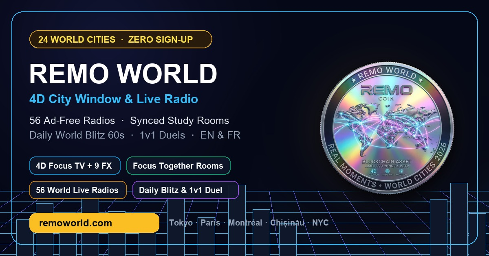

# 🌐 REMO World — 4D World Cities, Focus TV, 56 Live Radios & Viral Travel Studios

**REMO World** ([https://remoworld.com](https://remoworld.com/)) is a free bilingual (**English & French**) 4D World Cities web platform connecting **24 iconic metropolises** — including Montréal, Paris, Chișinău, Bucharest, New York, Tokyo, London, Dubai, Rome, Seoul, Barcelona, Berlin, Amsterdam, Lisbon, Sydney, Rio, and Cairo — with zero sign-up required to explore.

---

## ✨ Live Experiences & Free Browser Tools

- 📺 **[4D Focus TV Ambient Windows](https://remoworld.com/focus-tv.html)** — Fullscreen living city windows with real-time Open-Meteo weather, rain/snow/neon/fireplace FX, Zen Desk Clock mode, and shareable Custom Vibe Links (`?tv=tokyo&fx=rain`).
- 👥 **[Synced Pomodoro Study Rooms](https://remoworld.com/study-room.html)** — Study Together links (`?tv=tokyo&fx=rain&room=study25`) with shared focus timers and ad-free Lofi streams.
- 📻 **[56 Ad-Free Live World City Radios](https://remoworld.com/world-radio.html)** — Stream local stations from all 24 cities plus curated Lofi, Night Jazz, and Synthwave directly in your browser.
- ⏳ **[24 Live City Hubs (1910 vs 2026 Time-Warp)](https://remoworld.com/cities/index.html)** — Real-time local clocks, live weather, historical 1910 vs 2026 comparisons, verified city facts, and 4D Urban Pulse ratings.
- 🌍 **[My Travel Score (/24)](https://remoworld.com/travel-score.html)** — Interactive 24-city visited checklist with Explorer Tiers and free 9:16 HD Story PNG export.
- 🧠 **[Soul City Personality Quiz](https://remoworld.com/soul-city-quiz.html)** — 30-second personality test matching you to 1 of 24 global cities across 6 archetypes.
- 🎫 **[4D Panoramic Dual-City Boarding Pass](https://remoworld.com/boarding-pass.html)** — Generate free First-Class 9:16 boarding passes connecting any two cities (e.g., Chișinău `RMO` ⇄ Montréal `YUL`, Paris `CDG` ⇄ Tokyo `HND`).
- 🧩 **[Free Notion & Blog Live City Widget Studio](https://remoworld.com/widget.html)** — Embed a live city clock, °C weather, and 1-click radio badge into Notion, WordPress, or any blog (24 cities × 4 neon themes × EN/FR).
- ⚡ **[Daily World Blitz 60s & 1v1 Duels](https://remoworld.com/world-blitz.html)** — Daily 5-city geography challenge with Wordle-style share cards and URL-encoded 1v1 duels.
- 🧭 **[REMO Odyssey — Official 4D World Runner](https://remoworld.com/odyssey.html)** — Play across 24 real city skylines with live weather surges and 1v1 Ghost duels.
- ⚔️ **[World City Duels & 12 Head-to-Head Comparisons](https://remoworld.com/city-versus.html)** — Compare [Montréal vs Paris](https://remoworld.com/versus/montreal-vs-paris.html), [Chișinău vs Bucharest](https://remoworld.com/versus/chisinau-vs-bucharest.html), [New York vs London](https://remoworld.com/versus/newyork-vs-london.html), [Tokyo vs Seoul](https://remoworld.com/versus/tokyo-vs-seoul.html), and more.

---

## 🌍 Bilingual Access & AI Discovery

- **English Edition:** https://remoworld.com/
- **Édition Française:** https://remoworld.com/fr/
- **AI / LLM Documentation:** [llms.txt](https://remoworld.com/llms.txt) · [llms-full.txt](https://remoworld.com/llms-full.txt)
- **Sitemap (105 Canonical URLs + Google Images):** [sitemap.xml](https://remoworld.com/sitemap.xml)
